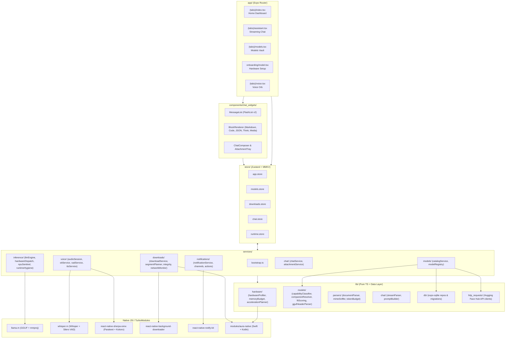
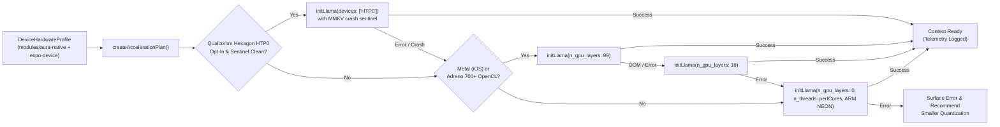
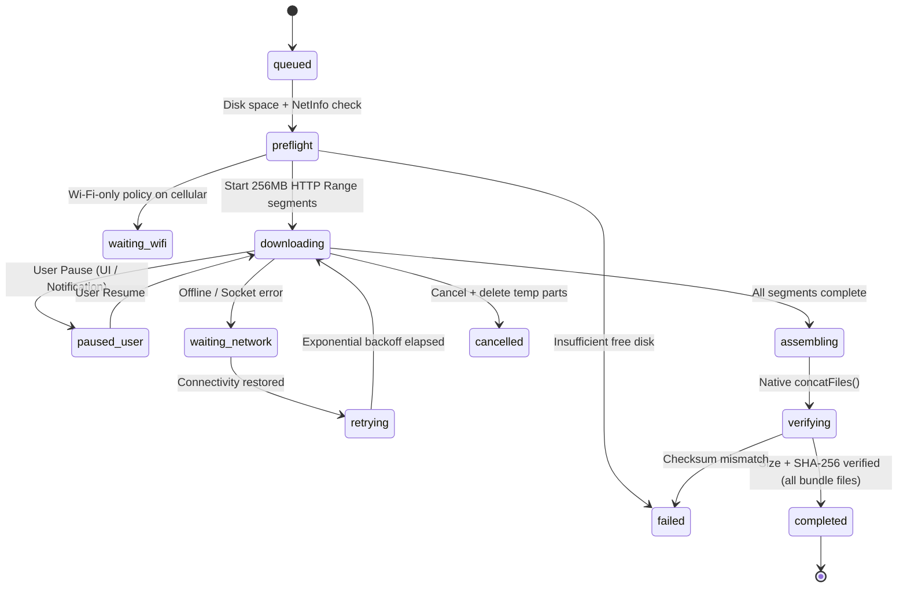
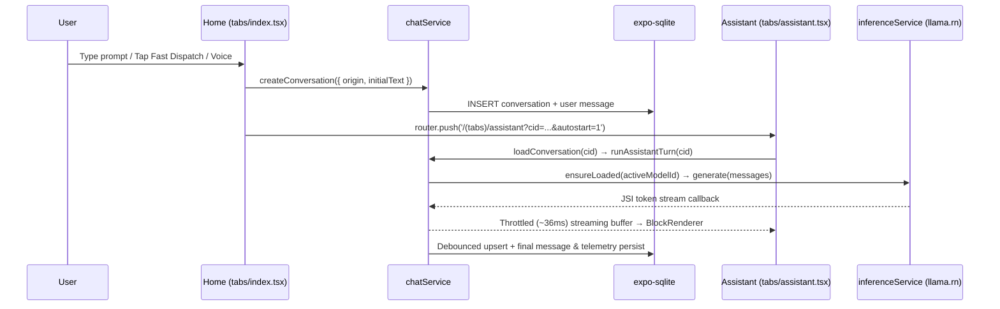

# Aura OS — 100% Offline-First On-Device AI Operating Environment

Aura OS is a cross-platform (**iOS & Android**) native mobile AI application built on React Native's New Architecture (JSI / TurboModules) and Expo SDK 56. Every token, transcription, image analysis, document parse, and neural speech synthesis runs **entirely on the user's device silicon** with zero cloud telemetry.

---

## Product Overview & Core Capabilities

- **100% Offline Execution & Privacy:** Conversations, model weights, catalog caches, and document parsing stay strictly on-device in SQLite and MMKV. The network is used exclusively when the user chooses to browse or download open-source models from Hugging Face Hub.
- **Hardware-Aware Onboarding & Models Vault:** Reads actual device silicon (SoC, CPU performance-core clusters, NEON/FP16/DotProd/I8MM instruction sets, Metal/OpenCL/Vulkan/Hexagon capabilities, live available RAM, safe Jetsam/Android memory ceiling, free storage, and thermal state) — never mocked or hardcoded.
- **Dynamic Open-Source Model Discovery:** Queries the Hugging Face Hub API for GGUF LLMs, Vision-Language Models (`mmproj` auto-paired atomically), Whisper/Parakeet ASR models, and Kokoro/OuteTTS neural voice models. Persists catalog data in SQLite so the vault remains browsable offline.
- **Real-Time Fit Scoring:** Estimates runtime memory (`weights × 1.25 + KV cache + projector + compute buffers`) against the device's safe RAM ceiling, classifying every quantization (`Optimal`, `Compatible`, `Tight Fit`, `Not Recommended`) and highlighting the best quantization for the device.
- **Resilient Background Model Downloads:** Uses native OS background transfer engines (`NSURLSession` on iOS, Android Foreground Service `dataSync` + background transfers) with 256 MB HTTP `Range` segments, automatic network-loss pause/resume with exponential backoff, native SHA-256 checksum verification, and lock-screen progress notifications with Pause/Resume/Cancel actions.
- **ChatGPT-Grade Streaming Assistant:** 60/120fps virtualized chat (`FlashList` v2) with memoized modular widgets: rich Markdown + scrollable tables, syntax-highlighted code blocks, collapsible JSON tree/raw viewer, `<think>` reasoning trace drawer with live timer, image grid + zoomable lightbox, audio waveform + transcript card, offline PDF/code/CSV/MD document cards, capability-mismatch banners (with 1-tap Vision model switching), and live tok/s + backend telemetry pills.
- **End-to-End Offline Voice:** Real-time 16 kHz mono PCM microphone capture with Silero VAD and `whisper.rn` (Core ML ANE on iOS) / `react-native-sherpa-onnx` (Parakeet), plus sentence-chunked offline neural TTS (`sherpa-onnx` Kokoro with native OS speech fallback only if no local TTS model is installed).

---

## Technical Architecture

### 1. Layered System Architecture



---

### 2. Hardware Acceleration & Crash-Safe Fallback Dispatch



| Chipset Family | Primary LLM Backend | Fallback Ladder | Thread Sizing | Whisper STT |
|---|---|---|---|---|
| **Apple A14–A19 / M-series** | Metal GPU (`n_gpu_layers=99`) | Partial Metal → CPU | Perf cores (2–6) | Core ML (ANE) + Metal |
| **Snapdragon 8 Gen 2 / 3 / Elite (Adreno 700+)** | Adreno OpenCL (`n_gpu_layers=99`) | Opt-in Hexagon `HTP0` (sentinel) → OpenCL → CPU | Prime + Perf cores (≤6) | CPU NEON |
| **Snapdragon 7-series / Adreno 6xx** | ARMv8.2+ NEON CPU | — | Perf cores | CPU NEON |
| **MediaTek Dimensity 9200/9300/9400** | ARMv9 NEON (`dotprod` + `i8mm`) CPU | — | Big + Prime cores | CPU NEON |
| **Samsung Exynos 2200/2400** | ARM NEON (`dotprod` / `i8mm`) CPU | — | Big + Prime cores | CPU NEON |
| **Google Tensor G2–G4** | ARM NEON CPU (thermal-aware) | — | Big + Mid cores (throttled on heat) | CPU NEON |

---

### 3. Resilient Segmented Background Download State Machine



---

### 4. Home → Assistant Streaming Sequence



---

## Project Folder Map

```text
aura-os/
├── app/
│   ├── _layout.tsx                 # Root layout, bootstrap, background notification registration
│   ├── onboarding/                 # 3-step onboarding with live hardware readiness & starter download
│   └── (tabs)/
│       ├── index.tsx               # Home dashboard → creates conversation & launches Assistant
│       ├── assistant.tsx           # Lean streaming chat screen backed by chat_widgets
│       ├── models.tsx              # Real hardware card, HF Hub discovery, fit scoring, downloads, vault
│       └── voice.tsx               # Offline voice orb wired to Whisper/VAD & chatService
├── components/
│   └── chat_widgets/               # Memoized MessageList, Markdown, Code, JSON Tree, Thinking, ImageGrid, Audio, DocumentCard, Composer
├── lib/
│   ├── types/                      # Core TypeScript schemas (hardware, models, downloads, chat)
│   ├── hardware/                   # hardwareProfiler, memoryBudget, accelerationPlanner
│   ├── models/                     # capabilityClassifier, companionResolver, fitScoring, ggufHeaderParser, quantization
│   ├── http_requests/              # Hugging Face Hub API clients (search, info, tree, Range GGUF header)
│   ├── parsers/                    # documentParser (TXT/MD/JSON/CSV/Code/PDF), mimeSniffer, tokenBudget
│   ├── chat/                       # streamParser (fuzz-tested incremental parser), promptBuilder
│   ├── db/                         # expo-sqlite schema, migrations, repos
│   └── hooks/                      # useHardwareProfile, useActiveModel, useDownloads, useVoiceInput
├── services/
│   ├── bootstrap.ts                # Deterministic startup orchestration
│   ├── inference/                  # llmEngine (llama.rn), hardwareDispatch, npuSentinel, runtimeHygiene, inferenceService
│   ├── voice/                      # audioSession, micCapture, sttService, vadService, ttsService, voiceService
│   ├── downloads/                  # downloadService, downloadQueue, segmentPlanner, integrity, networkMonitor, backoff
│   ├── notifications/              # notificationService (react-native-notify-kit), channels, lock-screen actions
│   ├── chat/                       # chatService, attachmentService (vision capability gating)
│   └── models/                     # catalogService (HF + SQLite cache), modelRegistry
├── store/                          # Zustand stores (app, models, downloads, chat, runtime)
├── modules/aura-native/            # Local Expo native module (Swift + Kotlin): hardware probe, concatFiles, SHA-256, PDFKit/PDFBox
└── plugins/withAuraNative.js       # Custom Expo config plugin (OpenCL/Hexagon, dataSync FGS, 16KB jniLibs, -O3 Release flags)
```

---

## How to Run

> **Important:** Because Aura OS runs native C++ AI engines (`llama.rn`, `whisper.rn`, `react-native-sherpa-onnx`) and custom Swift/Kotlin modules (`modules/aura-native`), **Expo Go is not supported**. You must build and run an **Expo Development Build** on a physical iOS or Android device (recommended for real Metal / Adreno GPU / NEON speeds).

### Prerequisites

- **Node.js** `>= 20` (tested on Node 24) & **npm** `>= 10`
- **iOS:** macOS with **Xcode 16+**, **CocoaPods**, and an Apple Developer account with the following capabilities enabled on your App ID (`com.aura.os` by default in `app.json`):
  - `Increased Memory Limit` (`com.apple.developer.kernel.increased-memory-limit`)
  - `Extended Virtual Addressing` (`com.apple.developer.kernel.extended-virtual-addressing`)
- **Android:** **Android Studio** with **Android SDK 36**, **NDK**, and **JDK 17** installed (`ANDROID_HOME` set in your shell).

### 1. Install Dependencies

```bash
npm install --legacy-peer-deps
```

### 2. Configure Bundle Identifier / Package Name (Optional)

Before prebuilding for your own Apple Developer team or Play Store signing key, update `ios.bundleIdentifier` and `android.package` in [`app.json`](./app.json).

### 3. Generate Native Projects (`expo prebuild`)

```bash
npm run prebuild
# Equivalent to: npx expo prebuild --clean
```

This applies `./plugins/withAuraNative.js` (Android `libOpenCL.so` / `libcdsprpc.so`, `foregroundServiceType="dataSync"`, `arm64-v8a`, 16 KB page-aligned `jniLibs`, and iOS `-O3` Podfile flags) and autolinks `modules/aura-native`.

### 4. Run on iOS (Physical Device Recommended)

```bash
# Development build
npm run ios
# Or target a connected physical iPhone in Release mode for full Metal speed:
npx expo run:ios --device --configuration Release
```

### 5. Run on Android (Physical Device Recommended)

```bash
# Development build
npm run android
# Or Release build for full Adreno OpenCL / ARMv9 NEON speed:
npx expo run:android --variant release
```

### 6. Run Verification Checks (Typecheck, Tests, Lint)

```bash
npm run typecheck   # TypeScript strict check (tsc --noEmit)
npm test            # Jest unit tests (hardware planner, classifier, GGUF parser, stream parser, budgets)
npm run lint        # ESLint + Prettier check
```

---

## Troubleshooting

- **iOS Simulator vs. Physical Device:** Metal GPU offloading and Apple Neural Engine (Core ML) are unavailable or throttled on the iOS Simulator. Always benchmark tokens/sec and test large GGUF models on a physical iPhone/iPad.
- **Android `libc++_shared.so` Duplicate Symbol Error:** Handled automatically by `plugins/withAuraNative.js` (`pickFirsts`). If you modify native dependencies, re-run `npm run prebuild`.
- **Background Downloads on iOS Force-Quit:** iOS discards `NSURLSession` resume tokens if the user manually swipes the app away from the app switcher. Aura OS mitigates this by splitting large weights into 256 MB HTTP `Range` segments and automatically resuming from the last completed segment on next launch.
- **Qualcomm Hexagon NPU Instability:** Hexagon `HTP0` offloading is opt-in and protected by an MMKV crash sentinel (`services/inference/npuSentinel.ts`). If a vendor driver crashes during initialization, Aura OS automatically blacklists Hexagon for that device fingerprint on the next launch and falls back to Adreno OpenCL or ARM NEON CPU.
